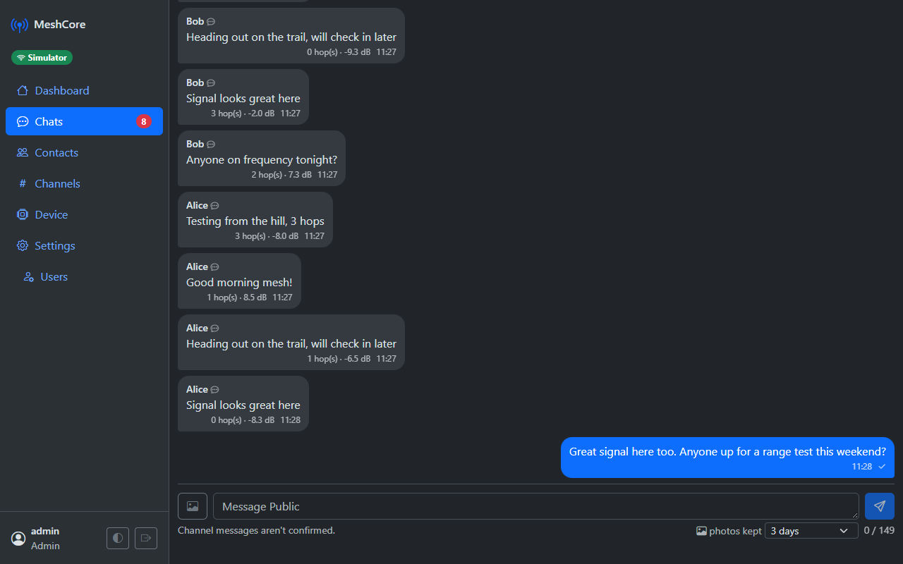
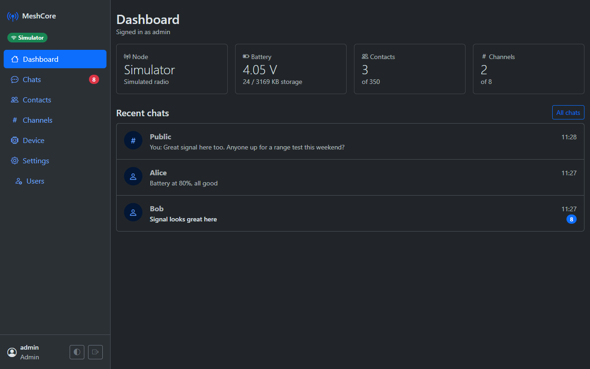
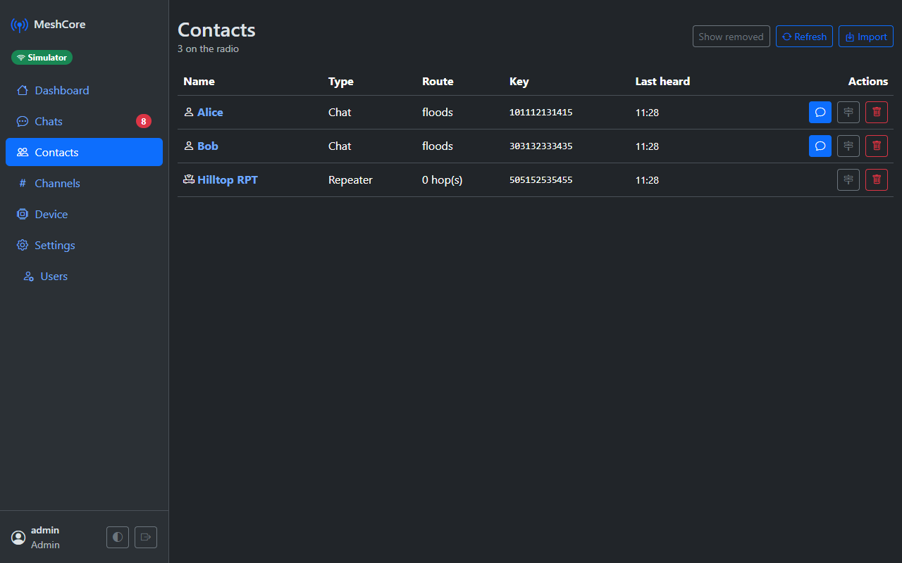
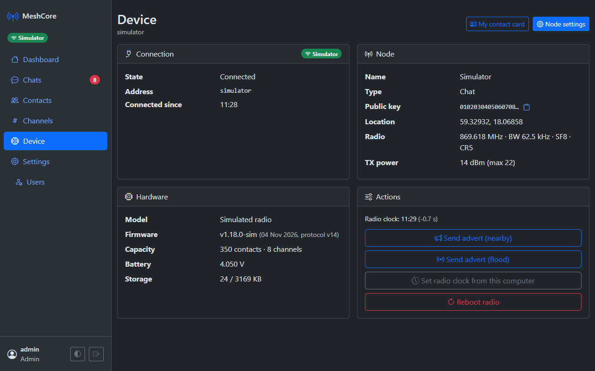
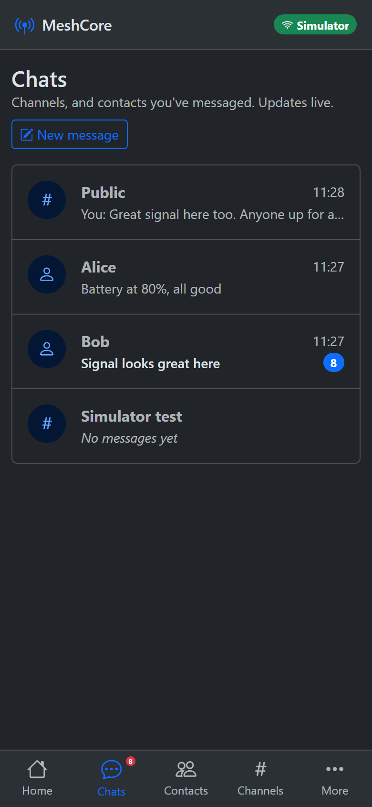
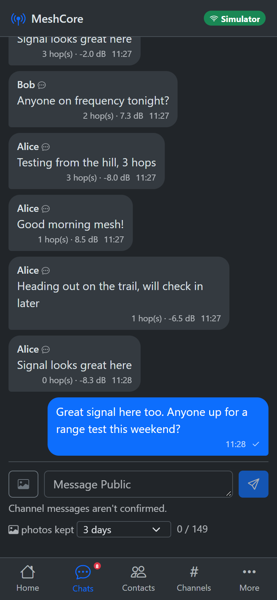
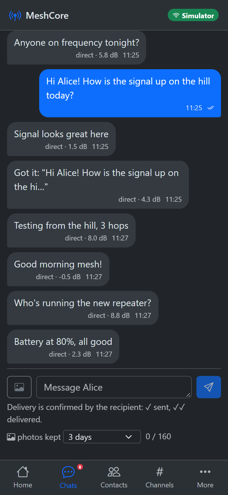

# MeshCore Computer Client

A .NET 10 app that connects to a [MeshCore](https://github.com/meshcore-dev/MeshCore) **companion radio** over
WiFi (TCP) or USB serial. It stores messages, contacts and channels in SQLite, and will host a REST API and a
responsive website (see [docs/PLAN.md](docs/PLAN.md)).

**Status:** all 8 planned phases done. See [docs/STATUS.md](docs/STATUS.md) for progress, tested hardware and code size.

**Installing it for real?** On Windows, download the zip from [Releases](https://github.com/RickardPettersson/meshcore-computer-client/releases):
no .NET needed. Then follow the [setup guide](docs/SETUP.md) to set it up, add HTTPS for phones, and run it as a service.

**Radio:** a Heltec V4 over WiFi works well. [docs/HELTEC-V4-WIFI.md](docs/HELTEC-V4-WIFI.md) shows how to build and flash the WiFi companion firmware.

**Releases** are built by GitHub Actions ([release.yml](.github/workflows/release.yml)) when a version tag is pushed:

```bash
git tag v1.0.0
git push origin v1.0.0
```

The same build can be run by hand: `./build/package-windows.ps1 -Version 1.0.0` gives `artifacts/release/*.zip`.

Developer reference for the radio protocol, with pinned firmware sources: [docs/PROTOCOL.md](docs/PROTOCOL.md).

## Requirements

- .NET 10 SDK to build or develop. The released Windows zip needs nothing installed.
- A MeshCore companion radio running the **WiFi** or **USB** companion firmware (the BLE build is not supported)

## Run (development)

Set the radio address in `src/MeshCore.Host/appsettings.json` (`MeshCore:Connection`), or pass it on the command line:

```bash
dotnet run --project src/MeshCore.Host -- --MeshCore:Connection=192.168.1.212:5000
```

When started in a terminal you get a console chat. Type text to send it to the current channel, or `/help` for the commands.
Data is stored in `src/MeshCore.Host/data/`: the SQLite database, encryption keys, and `appsettings.auth.json` with the users.

## Website

Open **http://localhost:5080** on this computer, or **http://&lt;this computer's IP&gt;:5080** from a phone on the same network.

1. The first visit asks you to create the **Admin** account.
2. As Admin, add people under **Settings → Users**. Each new user gets a temporary password and chooses their own at first sign-in.
3. On a phone you get a bottom tab bar. On a desktop you get a sidebar. Light/dark follows the system, with a toggle in Settings.
4. Chats are **live**: new messages appear without reloading, delivery ticks go ✓ → ✓✓, and each user has their own unread badges.
   On a phone, use the browser's "Add to Home Screen" to open it like an app.
5. In a channel, tap a sender's name to message them privately. That works when they're in your contacts under that exact name
   (channel messages only carry the name). Other names open a page explaining how to get them into your contacts:
   they send an advert, or you swap contact cards. It also has a button to send your own advert.
6. **Share a photo** with the 🖼 button next to the message box, or paste an image into it. The app shrinks the photo, removes
   its EXIF data (including GPS location) and uploads it to [Litterbox](https://litterbox.catbox.moe) (deleted after
   1 hour to 3 days) or [Catbox](https://catbox.moe) (kept), then puts the short link (~36 characters) in your message.
   Uploads aren't listed anywhere, but **anyone with the link can open it**, and messages in the Public channel can be read by
   everyone on the mesh. Choose how long photos are kept under the message box. See [setup](docs/SETUP.md#images).

Windows may ask to allow the app through the firewall the first time, so phones can reach port 5080.
For phones, use **HTTPS on port 5443**. The app makes its own certificate; open `/Account/Certificate` on the phone to install it (see the [setup guide](docs/SETUP.md#5-phones-https-and-install-as-app)).

| Port | What | Reachable from |
|---|---|---|
| 5080 | Website over HTTP (redirects to HTTPS) | your network (`Kestrel:Endpoints:Web`) |
| 5443 | Website over HTTPS | your network (`Web:Https`) |
| 5081 | REST API | this computer only (`Kestrel:Endpoints:Api`) |

## REST API

The API runs on http://127.0.0.1:5081/api/v1. In Development, you can explore and try every endpoint at http://127.0.0.1:5081/scalar.

```bash
# First run: create the Admin (only works once)
curl -X POST http://127.0.0.1:5081/api/v1/auth/setup -H "content-type: application/json" -d "{\"username\":\"admin\",\"password\":\"choose a long password\"}"
```

Send the returned `accessToken` as `Authorization: Bearer <token>`. Later sign-ins use `POST /api/v1/auth/token`.
Admins add more users with `POST /api/v1/users`. Each new user must change their temporary password at first sign-in.

**Images:** `POST /api/v1/images` (multipart: `file`, `expires` = `1h`/`12h`/`24h`/`72h`/`keep`) returns `{ url, expiresAt, … }`.

**Live updates:** connect a SignalR client to `http://127.0.0.1:5081/api/v1/hub`. Send the token as a bearer header,
or as `?access_token=` for WebSockets. It sends `message` (new message or delivery status), `radio`, `contacts` and `channels` events.

> The WiFi firmware serves **one client at a time**. While this app runs, don't connect the phone app or
> `meshcore-cli` to the same radio. If something else takes the radio over, the app waits 2 minutes before reconnecting.

## Radio features

- **Device → Node settings** (Admin): name, location, LoRa settings, TX power, tuning, preferences, and private key backup and restore.
  Change LoRa settings only to match your local mesh; with the wrong settings the node goes silent.
- **Device → My contact card**: your signed advert, for friends to import. Admins import cards under **Contacts → Import**.
- **Contacts → (a contact)**: trace route, telemetry, share, export card, favourite, and rename. For repeaters and room servers you can also log in and check status.
  After an admin login, turn on **CLI command** in that repeater's chat to send remote CLI commands; the replies appear in the chat.
- **Heard nodes**: when "add contacts manually" is on, newly heard nodes are listed on the Contacts page to add.

## Try it without a radio

The built-in simulator acts like a companion radio. It has contacts, channels, nodes that chat now and then, ACKs, and occasional replies.
Nothing is transmitted.

```bash
dotnet run --project src/MeshCore.Host -- --MeshCore:Connection=simulator --MeshCore:DataDirectory=data-sim
```

## Diagnostic CLI

```bash
dotnet run --project tools/MeshCore.Cli -- info --connect 192.168.1.212
```

The CLI commands are `ports`, `info`, `contacts`, `channels`, `messages`, `listen`, `send`, `send-channel`, `advert` and `cli`.
`cli` runs a command on the radio itself (firmware v14+), e.g. `cli get wifi.ip` or `cli set wifi.ssid MyNetwork`.

## Screenshots

Version 1.1.0, with the built-in radio simulator.

**Desktop**



| Dashboard | Contacts | Device |
|---|---|---|
|  |  |  |

**Phone**

| Chats | Channel | Private chat |
|---|---|---|
|  |  |  |

New screenshots for a later version: see [build/take-screenshots.cs](build/take-screenshots.cs).

## Develop

```bash
dotnet test MeshCore.slnx
dotnet tool restore
dotnet ef migrations add <Name> --project src/MeshCore.Data --startup-project src/MeshCore.Host --output-dir Migrations
```
